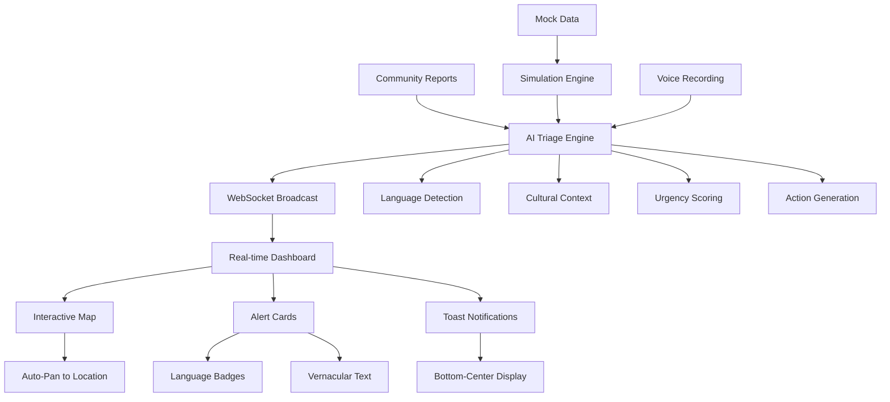

# MIDUSAFE
### Pan-African Disaster Response System

    


**MIDUSAFE** is a high-performance AI command center designed for disaster response and climate resilience across the African continent. It transforms the "noise" of a crisis—fragmented social media feeds, sensor data, and satellite imagery—into a single, actionable **Common Operational Picture (COP)**.

---

## 🌍 Pan-African Vision
In the first hours of a disaster, data is chaotic. MIDUSAFE uses multi-modal AI to fuse crowd-sourced intelligence with official data streams, allowing emergency managers to visualize verified threats and deploy resources with surgical precision across all 54 African nations.

**🚀 Bridging the "Last Mile" of Climate Communication in Africa**

## 🌍 Pan-African Multilingual AI Triage
- **Universal Language Detection**: Auto-detects ANY language including Sheng, Swahili, Dholuo, Amharic, French, Portuguese, Arabic, Hausa, Yoruba, Igbo, Zulu, Xhosa, Afrikaans, Somali, Tigrinya, Oromo, Wolof
- **Code-Switching Support**: Handles mixed-language sentences across all African languages
- **Cultural Context Awareness**: Extracts meaning from local terms and geographical references specific to each region
- **Native Dialect Labeling**: Identifies specific African dialects and regional variations
- **Ground Truth Display**: Shows original vernacular reports alongside professional English translations
- **AI-Generated Actions**: Suggests specific response actions (e.g., "Dispatch Red Cross to Kisumu Sector 4")

## 🚀 Production-Grade Command Center Features

### Unified Navigation & Mission Control
- **Consolidated h-16 Navbar**: Glass-morphism design with `bg-zinc-950/90 backdrop-blur-md`
- **Real-Time Clock**: Auto-timezone detection with `font-mono` display updating every 1000ms
- **Climate Metrics Strip**: Live CO2 (422ppm), Temperature (+1.2°C), Active Units (1,240)
- **Language Toggle Dropdown**: 10+ language support with flag indicators

### Advanced AI Triage Pipeline
- **Universal Language Support**: Enhanced Gemini prompt for any language detection
- **Enhanced Disaster Types**: structural_collapse, industrial_accident, gas_leak, landslide, storm, erosion, heatwave, disease_outbreak
- **Geospatial Intelligence**: Precise Kenyan location mapping using place names
- **Confidence Scoring**: 0.0 to 1.0 reliability assessment

### Professional UI/UX
- **Zero-Overlap Layout**: Fixed `pt-20` padding prevents navbar clipping
- **Bottom-Center Toasts**: 8-second duration with `z-[100]` and slide-up animations
- **Language Badges**: 🇬🇧 EN, 🇰🇪 SW, 🇰🇪 SH, 🇰🇪 LUO, 🇰🇪 KAL, 🇸🇴 SOM, etc.
- **Ground Truth Cards**: Original vernacular text with cultural context sections
- **Distinct Map Markers**: Color-coded for specific locations (Thika=Orange, KU=Blue, Wendani=Green)

### Voice Recording System
- **Browser MediaRecorder API**: Native audio capture with WAV output
- **Recording Controls**: Start, Pause/Resume, Stop with real-time timer
- **Visual Feedback**: Pulsing indicators and smooth state transitions
- **Transcription Ready**: Placeholder for speech-to-text integration

## 📍 Global-to-Local Geospatial Data
- **45+ Pan-African Incidents**: Covering all regions from Kenya to South Africa, Morocco to Mozambique
- **Hyper-Local Kenyan Spots**: Thika, Kenyatta University, Kahawa Wendani, Ruiru, Homa Bay, Westlands, Mathare
- **Continental Hotspots**: 
  - **Dar es Salaam, TZ**: Urban heatwave emergencies
  - **Bududa, UG**: Catastrophic landslides
  - **Beira, MOZ**: Cyclone aftermath
  - **Lagos, NGA**: Coastal erosion disasters
  - **Hargeisa, SOM**: Severe drought emergencies
  - **Addis Ababa, ET**: Industrial explosions
  - **Cape Town, ZA**: Red tide outbreaks
  - **Khartoum, SD**: Locust swarm invasions
- **Vernacular Reports**:
  - **Dholuo**: "Pi ochopo e dhoot e Homa Bay" (Water reached doorstep)
  - **Sheng**: "Mvua imepiga Wendani bypass ni river" (Rain hit Wendani, bypass is river)
  - **Code-Switching**: "Moto umekuwa serious, watu wanarun tao"
- **Precise Coordinates**: Map auto-pans to exact incident locations with smooth flyTo animations

## 🏗️ Technical Architecture



### Technology Stack
- **Frontend**: Next.js 14+, Tailwind CSS, Shadcn/UI, Framer Motion, Mapbox GL
- **Backend**: FastAPI (Python) with Gemini AI integration
- **Real-time**: WebSocket connections for live alert broadcasting
- **AI Engine**: Google Gemini 2.0 Flash for multilingual triage
- **Voice**: Browser MediaRecorder API for audio capture
- **Maps**: Mapbox Dark theme with auto-pan functionality

## 🛠️ Development Guide

### Key Components
- **Unified Navbar** (`/components/dashboard/unified-navbar.tsx`): Mission control strip with clock and language toggle
- **AI Triage** (`/triage.py`): Universal language detection and cultural context extraction
- **Voice Recording** (`/components/dashboard/community-report-button.tsx`): Full audio capture functionality
- **Live Feed** (`/components/dashboard/live-feed.tsx`): Multilingual alert cards with ground truth
- **Toast System** (`/components/ui/toast.tsx`): Bottom-center notifications with 8s duration

### Data Flow
1. **Report Input**: Text or voice → Community Report Button
2. **AI Processing**: Universal language detection → Cultural context → Translation
3. **Broadcast**: WebSocket → Real-time dashboard updates
4. **Display**: Language badges → Ground truth → Map markers

### Mock Data
- **Location**: `/data/mock-incidents.json` - 45+ Pan-African disaster scenarios
- **Simulation**: `python3 simulation.py` - Test multilingual reporting with 5-10 second cycling
- **Demo Mode**: Click "Demo Mode" button for 3 specific alert sequence (Dholuo, Sheng, English)

## 🚀 Quick Start

### Prerequisites
- Node.js 18+
- Python 3.8+
- Google Gemini API key

### Installation
```bash
# Backend
cd /home/levis/midusafe
source venv/bin/activate
pip install -r requirements.txt

# Frontend
cd dashboard
npm install
```

### Running the Application
```bash
# Start Backend (Terminal 1)
source venv/bin/activate
python3 main.py

# Start Frontend (Terminal 2)
cd dashboard
npm run dev

# Test Simulation (Terminal 3)
python3 simulation.py
```

### Environment Variables
```bash
# Backend
GEMINI_API_KEY=your_gemini_api_key

# Frontend (optional)
NEXT_PUBLIC_WS_URL=ws://localhost:8000/ws/alerts
```

## 🎯 Usage Instructions

### For Emergency Managers
1. **Monitor Dashboard**: Real-time alerts with language badges and cultural context
2. **View Ground Truth**: Original vernacular reports for authentic community voice
3. **Track Locations**: Color-coded map markers for precise incident locations
4. **Language Toggle**: Switch interface language for multilingual teams

### For Community Reporting
1. **Click Red Button**: Floating "Report Incident" button
2. **Voice or Text**: Record voice or type in any language
3. **Location**: Specify Kenyan location (Thika, KU, Wendani, etc.)
4. **Submit**: Real-time AI triage and dashboard broadcast

### Supported Languages
- **East Africa**: English, Swahili, Sheng, Dholuo, Kalenjin, Gikuyu, Luhya, Somali, Amharic, Tigrinya, Oromo
- **West Africa**: Hausa, Yoruba, Igbo, Wolof, French
- **Southern Africa**: Zulu, Xhosa, Afrikaans, Portuguese
- **North Africa**: Arabic, French
- **Code-Switching**: Mixed language sentences automatically handled across all African languages

## 🔧 Development Guidelines

### UI/UX Standards
1. **High-Urgency Design**: Dark modes, high-contrast alerts (Reds/Ambers), real-time animations
2. **Vernacular-First**: Always show original text with translation
3. **Cultural Sensitivity**: Respect local terminology and context
4. **Zero Overlap**: Proper z-index hierarchy and padding

### Code Architecture
1. **Modular Components**: Separate AI triage from mapping and UI
2. **TypeScript**: Strict typing for all interfaces
3. **Real-time First**: WebSocket-driven updates
4. **Responsive Design**: Mobile-first approach

### Testing
```bash
# Test multilingual scenarios
python3 simulation.py

# Test voice recording
# Click red button → Start Recording → Speak → Stop → Submit

# Test language detection
# Submit reports in: "Pi ochopo e dhoot", "Mvua imepiga", "Fire serious"
```

## 🌟 Production Features

### Command Center Ready
- **Professional UI**: Unified navbar with mission control strip
- **Real-time Clock**: Auto-timezone detection with live updates
- **Climate Metrics**: Live environmental data display
- **Language Intelligence**: Universal detection with cultural context

### Emergency Response
- **Ground Truth**: Original vernacular reports preserved
- **Cultural Context**: Local terminology explained
- **Geospatial Precision**: Kenyan location intelligence
- **Multilingual Teams**: Interface language switching

### Scalability
- **WebSocket Architecture**: Real-time for thousands of concurrent users
- **AI Triage**: Gemini 2.0 Flash for fast processing
- **Modular Design**: Easy feature addition and maintenance

---

## 🌟 Climate Hackathon Impact

### Demo Mode Features
- **3-Alert Sequence**: Perfect for pitch demonstrations
- **Language Diversity**: Showcases Dholuo, Sheng, and English processing
- **Auto-Pan Map**: Smooth flyTo animations to incident locations
- **Real-Time Processing**: Live AI triage and WebSocket broadcasting

### Competitive Advantages
- **Pan-African Coverage**: 45+ incidents across all African regions
- **True Multilingual**: 18+ African languages with cultural context
- **Production Ready**: Glassmorphism UI, real-time clock, climate metrics
- **Scalable Architecture**: WebSocket-driven for thousands of concurrent users
- **AI-Powered Actions**: Generates specific response recommendations

**MIDUSAFE** - Transforming emergency response through vernacular-first AI intelligence and cultural awareness. Built for Africa, ready for global climate challenges.